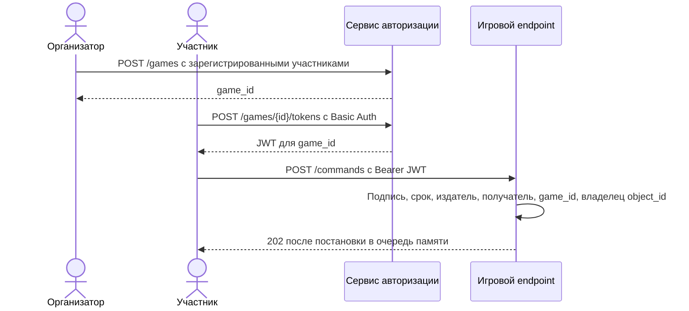

# Авторизация команд игры

ДЗ занятия 25 добавляет к существующей игре сервис выдачи JWT и проверку права отправить команду. В тексте задания встречаются старые слова про танки; здесь речь идет о кораблях «Космического боя». Прежние команды и `NewGameEndpoint` сохранены для уже написанных упражнений. Для сетевого игрового сервера используйте `NewAuthorizedGameEndpoint`.

## Поток запросов



Сервис авторизации проверяет пароль пользователя и его участие в игре. Он подписывает токен приватным ключом Ed25519. Игровой endpoint знает только публичный ключ, поэтому может проверить подпись, но не может выдать новый токен. Проверяются алгоритм, тип токена, `iss`, `aud`, `sub`, `exp`, `iat` и `game_id`. `sub` дополнительно сопоставляется с владельцем `object_id`, заданным при сборке защищенного endpoint. JWT подписан, но его payload не зашифрован: секреты в токен не кладутся. [RFC 8725](https://www.rfc-editor.org/rfc/rfc8725.html), [RFC 8037](https://www.rfc-editor.org/rfc/rfc8037.html).

## HTTP-контракт

| Запрос | Условие | Ответ |
| --- | --- | --- |
| `POST /games` с JSON `{"participants":["alice","bob"]}` | Организатор проходит HTTP Basic; все участники зарегистрированы | `201 {"game_id":"..."}` |
| `POST /games/{id}/tokens` | Пользователь проходит HTTP Basic и находится в списке участников | `200 {"access_token":"...","token_type":"Bearer","expires_in":300}` |
| `POST /commands` с `Authorization: Bearer ...` и прежним `AgentMessage` | Токен относится к игре, а `sub` владеет кораблем из `object_id` | `202` после постановки команды в существующую очередь |

Неверные учетные данные и токен дают `401`, пользователь вне списка участников или чужой корабль дают `403`. Токен действует пять минут. Ответ с токеном имеет `Cache-Control: no-store`. Пароли хранятся только как хеши PBKDF2-HMAC-SHA256 с индивидуальной солью; приватный ключ и файл пользователей не входят в репозиторий. [OWASP Password Storage](https://cheatsheetseries.owasp.org/cheatsheets/Password_Storage_Cheat_Sheet.html).

## Локальный запуск сервиса авторизации

Нужен Go 1.27. Сначала создайте папку `local-auth/`, она исключена из Git. Создайте ключ и его публичную часть:

```sh
mkdir -p local-auth
openssl genpkey -algorithm Ed25519 -out local-auth/private.pem
openssl pkey -in local-auth/private.pem -pubout -out local-auth/public.pem
chmod 600 local-auth/private.pem
```

Получите хеш пароля командой `go run ./cmd/auth-server hash-password`, передав пароль через стандартный ввод, затем поместите хеши в `local-auth/users.json`:

```json
{"alice":"pbkdf2-sha256:600000:<salt>:<hash>","bob":"pbkdf2-sha256:600000:<salt>:<hash>"}
```

Значения `<salt>` и `<hash>` здесь только обозначают поля. Используйте полную строку, которую выдала команда. Для локального запуска:

```sh
go run ./cmd/auth-server serve -users local-auth/users.json -private-key local-auth/private.pem
```

Сервис слушает `127.0.0.1:8095` по умолчанию. Для адреса вне loopback обязательно передать `-tls-cert` и `-tls-key`; HTTP Basic нельзя передавать по открытой сети. Пример запросов: `curl --user alice -H 'Content-Type: application/json' -d '{"participants":["alice","bob"]}' http://127.0.0.1:8095/games`, затем `curl --user alice -X POST http://127.0.0.1:8095/games/<game_id>/tokens`. `curl` запросит пароль, если после имени в `--user` нет двоеточия.

Для игрового endpoint загрузите `local-auth/public.pem` как Ed25519 PKIX public key, создайте `auth.NewTokenVerifier(publicKey)` и передайте его вместе с картой владельцев в `NewAuthorizedGameEndpoint(games, verifier, owners)`. Карта имеет вид `game_id -> object_id -> user_id` и должна покрывать каждый объект игры. Публичный HTTP сервер игры должен монтировать именно защищенный endpoint.

## Что пока остается за границей ДЗ

Реестр игр сервиса авторизации находится в памяти. После рестарта списки участников теряются, хотя ранее выданный короткоживущий токен игровой endpoint еще сможет проверить. Для постоянного сервиса понадобится хранилище участников, правила изменения состава игры, ротация ключей, отзыв доступа и ограничение частоты попыток входа.

Текущий Go-проект пока не запускает игровой HTTP сервер и не создает игру автоматически по ответу сервиса авторизации. Тесты собирают оба компонента с одним `game_id` и проверяют взаимодействие. Ответ `202` по-прежнему означает запись в очередь памяти, а не долговечную доставку или исполнение команды. Эти границы надо решить перед публичным развертыванием. Старый `NewGameEndpoint` оставлен только для прежних локальных упражнений.
