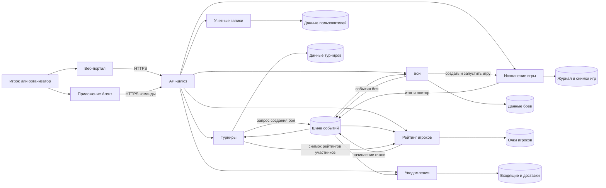
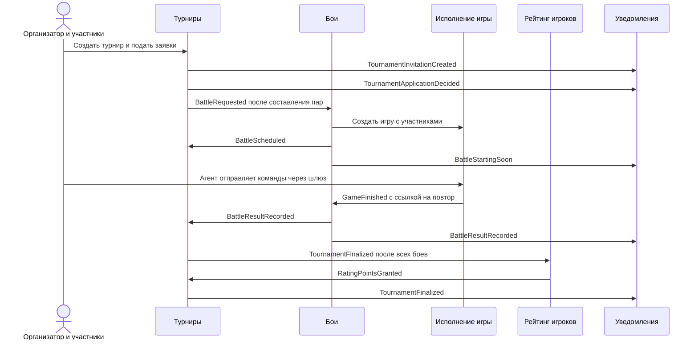

# Микросервисная архитектура «Космического боя»

Проектное решение для ДЗ занятия 23. Это целевая схема, а не описание уже запущенных сервисов. Сейчас репозиторий содержит Go-пакет с предметными командами, работниками и `http.Handler` для приема сообщений агентов. Отдельного сетевого процесса, регистрации пользователей, турниров, рейтинга, уведомлений и сохранения повторов боев пока нет. Схема сохраняет этот код как ядро будущего сервиса исполнения боя.

## Требования и принятые допущения

Из условия: играть могут зарегистрированные пользователи; бои бывают турнирными и по договоренности; пользователь может создать турнир, подать заявку, следить за результатами и посмотреть прошедший бой; участники получают уведомления; места в турнире дают рейтинговые очки; рейтинг турнира зависит от рейтинга участников и накапливается для регулярного турнира; программу игрока загружают в приложение «Агент».

Для схемы приняты следующие решения, которые надо уточнить перед реализацией:

- Один веб-портал обслуживает игрока и организатора с разными правами. «Агент» является отдельным клиентским приложением, которое запускает программу игрока и отправляет команды. Место запуска программы не задано; если его перенесут на сервер, понадобится изолированная среда выполнения и отдельный контракт загрузки.
- У турнира есть выпуски. Регулярный турнир связывает несколько выпусков одним `series_id`. Формула рейтинга турнира и таблица очков за места в условии отсутствуют. В схеме владельцы расчетов определены, а формулы остаются версионируемыми правилами.
- Бой с приглашением начинается после согласия участников. Точные правила отказа, времени ответа и составления турнирных пар надо согласовать. Сервис боя хранит явные состояния, поэтому эти правила можно добавить без изменения игрового движка.
- Целевые значения нагрузки, задержки и хранения повторов не указаны. Ниже заданы проверяемые инварианты и способы масштабирования, а числовые пороги надо получить из требований или измерений.

## Границы сервисов

Границы проведены по обязанностям, данным и причинам изменения. Отдельный сервис оправдан здесь для разных профилей нагрузки и независимого изменения правил: поток команд боя, чтение списка турниров, начисление очков и доставка уведомлений меняются по разным причинам. Разделение по техническим слоям вроде «сервис базы данных» оставило бы бизнес-операции распределенными по всем сервисам. [Декомпозиция по бизнес-возможностям](https://microservices.io/patterns/decomposition/decompose-by-business-capability.html).

| Часть | Владелец данных и правил | Основной повод для изменения |
| --- | --- | --- |
| Веб-портал | Интерфейс игрока и организатора, просмотр боев | Пользовательские сценарии и представление |
| Приложение «Агент» | Загрузка программы игрока и отправка команд | Протокол агента и среда выполнения программы |
| API-шлюз | Публичные маршруты, общая проверка сеанса, лимиты запросов | Внешний API и защита входа |
| Учетные записи | Регистрация, вход, идентификатор пользователя | Правила учетных записей |
| Турниры | Турниры, выпуски, заявки, решения, турнирная таблица, рейтинг турнира | Формат турнира, допуск, расчет рейтинга турнира |
| Бои | Приглашения, состав участников, расписание, статус, итог, ссылка на повтор | Правила организации и завершения боя |
| Исполнение игры | Состояние игрового поля, команды кораблей, журнал для повтора | Правила игры и нагрузка от команд |
| Рейтинг игроков | Очки за места, баланс и таблица лидеров | Схема начисления очков |
| Уведомления | Входящие уведомления, шаблоны и доставки | Каналы доставки и тексты |

Каждый сервис хранит свои данные и предоставляет доступ к ним через API или события. «Своя база» означает владение схемой и правами доступа; это не требует отдельного физического сервера базы для каждого сервиса. [Паттерн Database per Service](https://microservices.io/patterns/data/database-per-service).

Мы сравнили две осуществимые формы. Модульный монолит дал бы быстрый локальный запуск и простые транзакции, пока команда и нагрузка малы. Он потребовал бы общего деплоя турниров, уведомлений и горячего игрового цикла. Целевая схема отдельных сервисов дает независимое масштабирование и выпуск правил турниров без деплоя игры, но добавляет сеть, версии контрактов и эксплуатацию. В рамках ДЗ выбран второй вариант. Фактическое выделение сервисов следует подтверждать нагрузкой и частотой независимых изменений; один Go-пакет можно развивать до появления такого основания.

## Контейнеры и направления обмена

Сплошная стрелка означает вызов или публикацию в сторону получателя. Шина событий доставляет копии подписчикам. Хранилища принадлежат указанным сервисам, другие сервисы не читают их напрямую.

API-шлюз маршрутизирует запросы, но не владеет правилами турнира или боя. Проверка личности на входе не заменяет проверку прав в сервисе-владельце. Сервис игры должен проверять, что отправитель вправе управлять именно указанным `game_id` и `object_id`. Горячий путь команды не зависит от синхронного вызова сервиса учетных записей: после проверки сеанса сервис боев выдает короткоживущее подтверждение права на конкретный бой и корабли; сервис игры проверяет его локально. Формат и механизм отзыва этого подтверждения требуют отдельного проектирования перед реализацией.

## HTTP endpoints и приложения

Это предлагаемый внешний контракт `v1`. Маршруты шлюза с префиксом `/api/v1` передаются сервисам-владельцам. Методы для внутренних вызовов перечислены отдельно. Имена полей приведены для ясности границы, а полные схемы сообщений будут зафиксированы при реализации в OpenAPI. [Спецификация OpenAPI](https://spec.openapis.org/oas/).

| Получатель | Endpoint или исходящий вызов | Назначение и проверка |
| --- | --- | --- |
| Веб-портал | Исходящие `HTTPS /api/v1/...` | Вход, заявки, приглашения, результаты, рейтинг, повтор; входящих серверных endpoints нет |
| «Агент» | Исходящие `POST /api/v1/battles/{id}/access`, `POST /api/v1/games/{game_id}/commands` | Загружает программу игрока, получает право на бой и передает ее команды; входящих серверных endpoints нет |
| API-шлюз | `GET/POST /api/v1/...` | Проверяет сеанс, ограничивает поток запросов, передает их сервису-владельцу; сам не хранит предметные данные |
| Учетные записи | `POST /users`, `POST /sessions`, `GET /internal/users/{user_id}` | Регистрация, вход, чтение статуса учетной записи; секреты и профиль не передаются через шину событий |
| Турниры | `GET /tournaments`, `POST /tournaments`, `GET /tournaments/{id}` | Список будущих и прошлых турниров с пагинацией, создание и просмотр; создать может зарегистрированный пользователь |
| Турниры | `POST /tournaments/{id}/invitations`, `POST /tournaments/{id}/applications`, `POST /tournaments/{id}/applications/{application_id}/decision` | Приглашение от организатора, заявка участника и решение по ней; повтор запроса не создает дубликат |
| Турниры | `GET /tournaments/{id}/results`, `GET /tournaments/{id}/rating` | Результаты текущего или завершенного выпуска и рейтинг турнира или серии |
| Бои | `POST /battles`, `POST /battles/{id}/invitations/{user_id}/response` | Бой по договоренности и ответ приглашенного; только участник может ответить за себя |
| Бои | `GET /battles/{id}`, `GET /battles/{id}/replay`, `POST /battles/{id}/access` | Статус, авторизованный просмотр записи и получение права агента на бой; доступ проверяется по участию или разрешению просмотра |
| Исполнение игры | `POST /games/{game_id}/commands` | Проверка прав на игру и объект, `operation_id`, `args`, ключа повтора; `202` только после надежной фиксации приема в целевой реализации |
| Исполнение игры | `POST /internal/games`, `GET /internal/games/{game_id}/replay` | Запуск игры сервисом боев и выдача ссылки или потока повтора после завершения |
| Рейтинг игроков | `GET /players/{user_id}/rating`, `GET /leaderboard`, `POST /internal/rating-snapshots` | Очки игрока, таблица и снимок рейтингов участников для расчета рейтинга турнира |
| Уведомления | `GET /notifications`, `POST /notifications/{id}/read` | Входящие уведомления пользователя и отметка о прочтении; доставка по внешнему каналу выполняется адаптером сервиса |

Внешний путь команды отображается на существующий внутренний `POST /commands` из `GameEndpoint` с полями `game_id`, `object_id`, `operation_id`, `args`. Сейчас этот обработчик только проверяет JSON и ставит команду в очередь памяти. В нем нет проверки личности, права управлять кораблем, ключа повтора и надежного хранения. Открывать его напрямую в публичной сети нельзя; целевой контракт требует дополнительного входного адаптера и изменения границы подтверждения `202`. [Семантика HTTP 202](https://www.rfc-editor.org/rfc/rfc9110.html#section-15.3.3).

## События и последовательность сценария

В каждом событии нужны `event_id`, `aggregate_id`, `occurred_at`, `schema_version` и предметная нагрузка без лишних персональных данных. Событие означает уже зафиксированный факт. Команда `BattleRequested` выражает просьбу создать бой и не должна называться фактом завершенного боя. Имена событий в таблице являются частью предлагаемого контракта, а не существующего кода.

| Сообщение | Отправитель -> получатель | Назначение |
| --- | --- | --- |
| `TournamentInvitationCreated` | Турниры -> Уведомления | Пригласить зарегистрированного пользователя на турнир |
| `TournamentApplicationDecided` | Турниры -> Уведомления | Сообщить участнику решение по заявке |
| `BattleRequested` | Турниры -> Бои | Создать турнирный бой для определенных участников и раунда |
| `BattleInvitationCreated` | Бои -> Уведомления | Приглашение в бой по договоренности |
| `BattleStartingSoon` | Бои -> Уведомления | Напоминание перед началом запланированного боя |
| `BattleScheduled` | Бои -> Турниры, Уведомления | Сохранить привязку турнирного боя и уведомить участников |
| `GameFinished` | Исполнение игры -> Бои | Один подтвержденный итог игры и ссылка на журнал повтора |
| `BattleResultRecorded` | Бои -> Турниры, Уведомления | Показать результат и обновить состояние турнира |
| `TournamentFinalized` | Турниры -> Рейтинг игроков, Уведомления | Передать места и версию правил для начисления очков |
| `RatingPointsGranted` | Рейтинг игроков -> Турниры | Обновить представление результатов и связанной серии |

Бои по договоренности используют сервис боев без турнира: приглашение, согласие, запуск игры и сохранение результата остаются теми же. Для просмотра прошедшего боя веб-портал запрашивает `GET /battles/{id}/replay`; сервис боев проверяет право и получает запись через API сервиса игры. Браузер не читает внутреннее хранилище игры напрямую.

Повтор должен показывать тот же бой после изменения правил игры. Для этого требуется хранить достаточную последовательность состояний или событий вместе с версией правил и исходными данными. Простое повторное исполнение старых команд на новой версии кода не дает такой гарантии.

## Согласованность и обработка отказов

Турнир, бой и рейтинг изменяют свои данные в локальных транзакциях. Публикующий сервис сохраняет исходящее сообщение вместе со своим изменением в outbox, затем отдельный отправитель передает его в шину. Подписчик хранит факт обработки в своей базе. Это предотвращает потерю события после локального коммита, но доставка может повторяться. [Transactional Outbox](https://microservices.io/patterns/data/transactional-outbox.html), [Idempotent Consumer](https://microservices.io/patterns/communication-style/idempotent-consumer.html).

- Для `BattleRequested` естественный ключ повтора - `(tournament_id, round_id, pairing_id)`. Повтор не создает второй бой.
- Для `GameFinished` у боя допустим только один финальный результат по `battle_id`. Конфликтующие повторные результаты требуют расследования, а не молчаливого перезаписывания.
- Для очков нужен уникальный бизнес-ключ `(tournament_id, user_id, policy_version)` и журнал начисления. Повтор `TournamentFinalized` не увеличивает очки второй раз.
- Рейтинг турнира вычисляется из снимка рейтингов участников на заранее выбранный момент. Сервис турниров сохраняет снимок и версию формулы; недоступность сервиса рейтинга переводит расчет в ожидающее состояние, не отменяя уже завершенный бой. Для регулярного турнира результат каждого выпуска сохраняется отдельно, затем применяется правило накопления серии.
- Если сервис игры принял команду и ответил `202`, целевая версия должна восстановить ее после сбоя. Текущая очередь памяти этого не гарантирует. Отдельно нужны ключ повторной отправки команды и определение момента, после которого действие считается выполненным.

Порядок событий гарантируется только в пределах выбранного ключа агрегата при соответствующей настройке шины; глобальный порядок между турнирами и боями не предполагается. Схемы сообщений следует версионировать и проверять на совместимость до раздельного деплоя. Сетевой вызов может завершиться таймаутом после успешной обработки на другой стороне, поэтому вызывающая сторона повторяет только операции с определенным ключом идемпотентности.

## Узкие места и способы проверки

| Условие и риск | Решение | Проверяемый результат |
| --- | --- | --- |
| Много одновременных игр перегружает один работник или процесс | Разделять игры по `game_id` между экземплярами, оставляя одного активного владельца каждой игры; ограничить длину очереди и давать обратное давление | Две копии сервиса не исполняют команды одной игры одновременно; нагрузочный тест показывает задержку приема и длину очереди |
| Сбой процесса после `202` теряет сообщение из памяти | Хранить прием и прогресс команды в журнале, восстанавливать владельца игры по снимку и журналу | После принудительного завершения и перезапуска принятая команда либо выполнена один раз, либо имеет наблюдаемый статус для безопасного повтора |
| Список и результаты турниров читают гораздо чаще, чем меняют | Пагинация, отдельная читающая проекция и кэш с обновлением после событий | Рост чтений не увеличивает задержку приема команд игры; время от изменения результата до обновления выдачи измеряется |
| Одновременное окончание множества боев создает всплеск уведомлений и начислений | Раздельные подписчики, ограниченная конкуренция, очереди повторов и наблюдение за задержкой | Повтор доставки не дублирует очки или уведомление; очередь догоняет поток после всплеска |
| Повторы боев становятся тяжелыми для базы и веб-сервера | Журнал и готовые записи хранить отдельно от метаданных боя, отдавать поток или ограниченную по времени ссылку после проверки доступа | Просмотр длинного повтора не задерживает прием команд новой игры |
| Проверка учетной записи на каждую команду добавляет сетевую задержку и зависимость | Проверять ограниченное по времени право на конкретный бой локально в сервисе игры; определить отзыв права | При недоступности сервиса учетных записей действующий агент продолжает бой до истечения права; чужой `object_id` отклоняется |

Числовые цели для этих проверок не установлены в ДЗ. Их надо задать после выбора ожидаемого числа игроков, длительности боя, частоты команд и срока хранения повторов. Отдельный сервис не ускоряет систему автоматически: он добавляет сетевые вызовы, новые точки отказа и эксплуатационные расходы. [Monolith First](https://martinfowler.com/bliki/MonolithFirst.html).

## Изменяемые требования и OCP

OCP здесь означает локализовать ожидаемый вид изменения и оставить устойчивые контракты соседних частей. Он не запрещает править код сервиса-владельца.

| Вероятное изменение | Место расширения | Что остается стабильным |
| --- | --- | --- |
| Новый вид действия корабля или правило игры | Фабрика команды и разрешенный ключ в области IoC конкретной игры; существующий `InterpretCommand` уже использует этот маршрут | Формат входного сообщения и HTTP-обработчик, если аргументы новой операции остаются в `args` |
| Иной способ составления турнирных пар или допуска заявки | Версионируемая политика внутри сервиса турниров, например `PairingPolicy` и `AdmissionPolicy` | Сервисы боя, игры и внешнее чтение списка турниров |
| Другая формула очков за место или рейтинга турнира | Политика очков в сервисе рейтинга и политика рейтинга турнира в сервисе турниров, обе с версией в результате | Старые начисления и результаты выпусков, если хранить версию расчета |
| Новый канал уведомления или шаблон | Адаптер доставки и шаблон в сервисе уведомлений | Издатели предметных событий |
| Новый способ просмотра повтора | Адаптер чтения и формат представления в сервисе боев | Журнал игры и факт завершения боя |

Например, правило «швейцарская система пар» добавляется в сервис турниров как новая политика составления пар. Оно не должно менять код движения корабля или начисления очков. Проверка OCP - реализовать такой вариант в одном владельце, затем запустить сценарии прежнего и нового турнира. Интерфейсы для еще неизвестных вариантов заранее в код не добавляются.

## Переход от нынешнего Go-кода

| Сейчас в `main` | Потребуется для целевой схемы |
| --- | --- |
| `Move`, `Rotate`, макрокоманды и IoC | Сохранить как игровое ядро, дополнять новыми правилами игры |
| `CommandWorker` с очередью в памяти | Хранение принятых команд и состояния игры, восстановление после сбоя, распределение игр по владельцам |
| `GameEndpoint` с `POST /commands` и ответом `202` после постановки в память | Проверка игрока и корабля, ключ повтора, надежный прием, наблюдаемый итог команды |
| Локальный `Worker.Failures()` | Сохраняемая диагностика и результат, доступный владельцу боя или оператору |
| Нет отдельного сетевого процесса | Сборка исполняемого сервиса и конфигурация запуска после появления требования реализовать API |

В этом ДЗ требуется архитектурная модель, поэтому существующий Go-код не изменяется. При следующих заданиях переход следует делать добавлением адаптеров и сервисов поверх работающего ядра, проверяя старые команды и контракты.

## Проверка полноты ДЗ

| Пункт задания | Где показан |
| --- | --- |
| Набор сервисов и приложений | Таблица границ и контейнерная схема |
| Направления сообщений и endpoints | Схема, таблица HTTP, таблица событий и последовательностная схема |
| Узкие места и масштабирование | Таблица условий, решений и проверяемых результатов |
| Изменяемые компоненты и OCP | Таблица изменений и пример новой схемы турнирных пар |
| Текстовые пояснения и сохранение в git | Этот документ в репозитории, ссылка из README |

## Источники

- [Страница занятия 23 OTUS](https://otus.ru/learning/406085/): оцениваемое условие ДЗ про архитектуру «Космического боя».
- [Декомпозиция по бизнес-возможностям](https://microservices.io/patterns/decomposition/decompose-by-business-capability.html), [владение данными](https://microservices.io/patterns/data/database-per-service), [outbox](https://microservices.io/patterns/data/transactional-outbox.html) и [идемпотентный потребитель](https://microservices.io/patterns/communication-style/idempotent-consumer.html): первичные описания примененных паттернов.
- [C4: контейнеры](https://c4model.com/diagrams/container) и [динамические схемы](https://c4model.com/diagrams/dynamic): назначение двух видов диаграмм.
- [RFC 9110, 202 Accepted](https://www.rfc-editor.org/rfc/rfc9110.html#section-15.3.3): граница подтверждения асинхронного приема.
