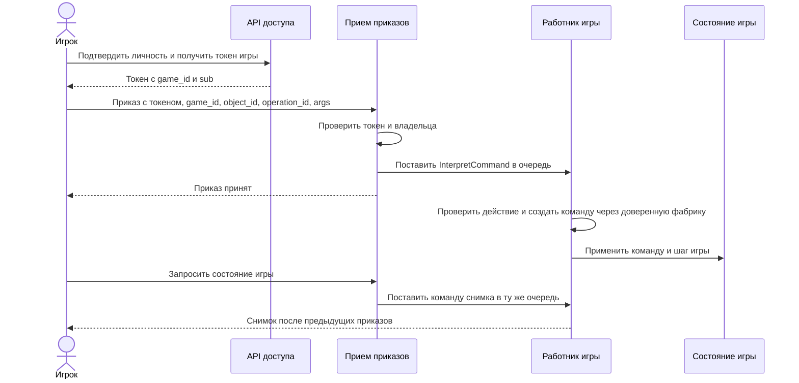
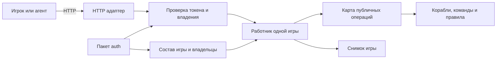
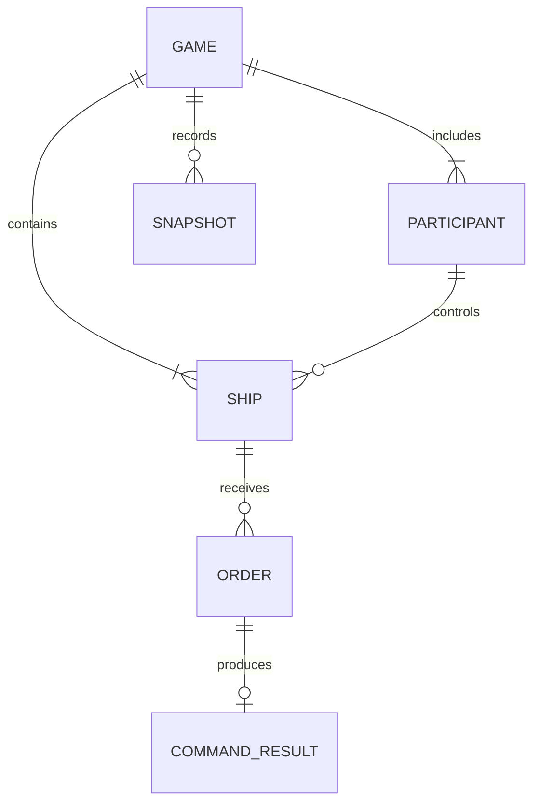

# Космический бой: проектный план

## Задача и первая демонстрация

Игрок управляет своим кораблем через ограниченный набор приказов. Сервер проверяет личность и право на корабль, выполняет приказы в порядке игры и дает наблюдать результат боя. Первая демонстрация должна показать полный путь для двух игроков: получить доступ к одной игре, запустить и остановить движение, сделать игровой шаг, попытаться управлять чужим кораблем и увидеть отказ. Позже бой получит попадания, завершение и повтор.

Это план продукта, а не заявление о готовности всех частей. Пакет Go выполняет движение, поворот, команды `StartMove`, `StopMove`, `Shoot`, обрабатывает очередь, проверяет токен и владельца в `NewAuthorizedGameEndpoint`. `cmd/battle-demo` уже соединяет эти части в одном локальном HTTP-процессе: создает одну игру и двух участников, выдает токены, принимает `StartMove`, `StopMove` и `Advance`, показывает снимок через `GET /state`. Отдельный `cmd/auth-server` существует, но два процесса не синхронизируют создание игр. Сохраняемого результата приказа, динамического каталога игр и завершения боя пока нет.

## Выбор структуры

Для первой работающей версии выбран модульный монолит: один запускаемый сервис с отдельными модулями авторизации, приема приказов, исполнения игры и чтения состояния. Существующее приложение авторизации и его пакет сохранены. Демо использует пакет `auth` в том же процессе, не изменяя контракты игрового ядра. Это устраняет необходимость согласовывать создание игры между двумя процессами до появления работающего сценария.

Альтернатива - сразу запустить отдельные сервисы авторизации и игры. Тогда уже на первом шаге нужны синхронизация `game_id` и участников, контракт создания игры, обработка частичных отказов и тесты двух процессов. Сейчас нет требования независимого масштабирования или развертывания этих частей. Разделение стоит пересмотреть, когда появится реальный отдельный профиль нагрузки, команда-владелец или обязательное независимое развертывание. [Целевая схема нескольких сервисов](microservices.md) остается вариантом развития, а не описанием первой версии.

| Решение | Причина | Цена и условие пересмотра |
| --- | --- | --- |
| Один процесс на первую демонстрацию | Один источник состава игры и владения кораблями, проверяемый путь запроса | При независимом развертывании придется оформить сетевой контракт и согласованность создания игр |
| Один работник на игру | Упорядоченное изменение состояния кораблей без блокировки каждого поля | Снимки для HTTP нельзя читать напрямую из другой goroutine; при росте нагрузки нужны измерения и распределение игр |
| Публичные имена приказов через доверенную карту фабрик | Новая игровая команда добавляется без правки HTTP-обработчика | Схемы параметров и версия протокола должны быть совместимы с клиентом |
| Наблюдаемый результат приказа до обещания надежности | `202` сейчас подтверждает только очередь памяти | Идентификатор приказа, хранение и правила повтора нужны до внешнего обещания доставки |

## Бизнес-процесс

1. Организатор создает игру для двух зарегистрированных игроков. Игра получает `game_id`, а каждый корабль - `object_id` и владельца.
2. Игрок подтверждает личность и получает краткоживущий токен для этой игры.
3. Агент игрока отправляет приказ своему кораблю. HTTP-обработчик проверяет токен, игру и владельца до очереди. Работник проверяет публичное действие по разрешенному списку перед созданием игровой команды.
4. Работник последовательно исполняет приказ и игровой шаг. Игрок может прочитать состояние; итог отдельного приказа пока доступен только внутри процесса.
5. Когда появятся правила попаданий и победы, бой фиксирует результат и последовательность изменений для просмотра.

В первой демонстрации организатором выступает локальная конфигурация запуска, а состояние живет в памяти. Динамическое создание игр, надежное хранение и просмотр прошедшего боя относятся к следующим шагам.

## Функциональный поток первой версии

Демо реализует чтение снимка командой в той же очереди. Прямое чтение `Ship.Position()` из HTTP goroutine нарушило бы правило владения изменяемым состоянием: `Ship` не синхронизирован. Снимок показывает состояние после предыдущих принятых приказов, но не сообщает результат каждого приказа отдельно. Для этого еще нужен `command_id` и отдельный статус.

## Компоненты и владение

На старте `Catalog` может собираться при запуске. Его инвариант: каждый `object_id` в игре имеет ровно одного владельца, и это соответствие одинаково для выдачи токена и приема приказа. Изменение владельца во время игры потребует отдельного правила и проверки уже принятых приказов.

## Информация и контракты

`ORDER`, `COMMAND_RESULT` и `SNAPSHOT` показаны как предметные записи. Наличие связи на схеме не означает, что для нее уже есть таблица. У снимка есть локальный API, но нет сохраняемого журнала.

| Запись | Минимальные поля | Владелец и статус |
| --- | --- | --- |
| Игра | `game_id`, участники, состояние | Реестр `auth` хранит участников в памяти; демо собирает одну игру с тем же ID в игровом ядре |
| Корабль | `object_id`, `owner_id`, положение, направление, скорость | Игровой работник меняет состояние; карта владельцев сейчас копируется в endpoint |
| Приказ | `game_id`, `object_id`, `operation_id`, `args` | Входной `AgentMessage` уже реализован; клиентского `command_id` пока нет |
| Результат приказа | `command_id`, статус, ошибка, номер шага | Планируется; текущий `Worker.Failures()` доступен только внутри процесса |
| Снимок боя | номер шага, состояния объектов, версия правил | Демо выдает текущие положения, скорости и направления через очередь; номер шага, версия правил и хранение еще не реализованы |

Интеграции первой версии: HTTP для приказов, JWT EdDSA для доступа к игре и вызовы внутри Go-процесса для игрового ядра. При отделении авторизации потребуется контракт синхронизации состава игры; одних подписанных токенов недостаточно для создания соответствующего `Game` и карты владельцев. База данных, брокер, Docker и виртуальная машина не являются условием первого локального сценария. Их добавление должно закрывать конкретное требование к сохранению, доставке или развертыванию.

## Шаблоны и изменение кода

- `Command` изолирует игровой шаг и приказ как исполняемое действие. Очередь задает порядок внутри игры.
- Фабрики в IoC переводят проверенное публичное действие в конкретную команду. IoC остается частью сборки и границы интерпретации; предметная логика не должна искать в нем произвольные зависимости.
- `State` уже описывает режимы работника. Его не следует переносить на каждое поле корабля ради единообразия.
- Политику расчета попадания или победы можно выделить отдельно, когда появятся хотя бы два реальных варианта правил. Пока это будущая причина изменения, а не повод вводить пустой интерфейс.

Проверка расширения: добавить новую разрешенную команду через фабрику и конфигурацию, не меняя HTTP-контракт и старые команды; старые и новые сценарии должны проходить вместе. Проверка доступа: токен другого игрока для того же `object_id` дает отказ и не меняет состояние. Системные операции не должны получать полномочия из строки `operation_id`.

## Сценарии качества и план работ

| Сценарий | Наблюдаемый критерий | Сейчас |
| --- | --- | --- |
| Чужой игрок отправляет приказ кораблю | Отказ до очереди, состояние корабля прежнее | Проверено для существующего endpoint тестом |
| Два приказа в одну игру приходят последовательно | Работник исполняет их в установленном порядке | Сквозной HTTP-тест и живой запуск показывают порядок `StartMove`, `Advance`, затем снимок |
| Игрок спрашивает итог после `202` | Получает свой результат или явный статус ожидания | `GET /state` показывает итоговое состояние, но нет статуса конкретного приказа |
| Процесс перезапускается после приема | Принятый приказ либо восстанавливается, либо клиент получает честную политику повтора | Очередь в памяти, восстановление не реализовано |

Порядок следующих изменений:

1. Собрать один запускаемый процесс с двумя игроками и одной игрой. Использовать существующие пакет `auth`, авторизованный endpoint, работник и команды. Показать успешный приказ и отказ чужому игроку через HTTP. Выполнено в `cmd/battle-demo`.
2. Безопасно читать состояние через владельца и добавить детерминированное действие. В демо `GET /state` проходит через очередь, а `Advance` делает один шаг выбранного корабля. Следующая часть - общий каталог динамически создаваемых игр и явно определенный номер шага.
3. Добавить `command_id` и наблюдаемый статус. Отдельно определить повтор после сетевой ошибки и перезапуска; затем выбрать хранение.
4. Добавить конечный результат боя, проверку попаданий и журнал для воспроизведения. Проверить, что повтор дает тот же итог на зафиксированной версии правил.
5. Только после работающего сквозного сценария решить, нужно ли разделить приложения и развернуть их отдельно. Проверить отказ одного процесса и согласованность создания игры.

Критерий готовности первого показа: новый человек может запустить сервис по README, выполнить команды двух игроков, увидеть изменение состояния и отказ на чужой объект, а тесты `go test ./...` и `go test -race ./...` проходят. Для итоговой презентации нужны отдельные 15 минут: проблема и сценарий, решение и границы, показ, проверка свойств качества, ограничения и дальнейшие шаги. Внешнее развертывание и отправка в учебную систему выполняются только при отдельной необходимости.
